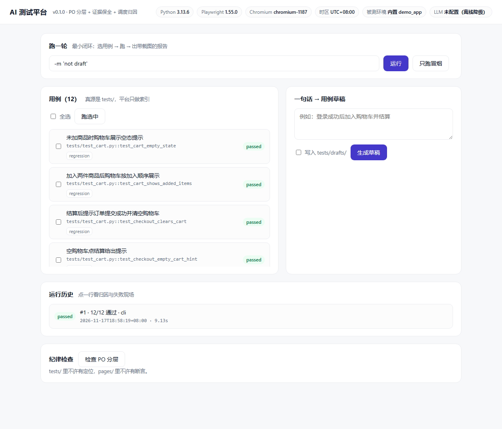
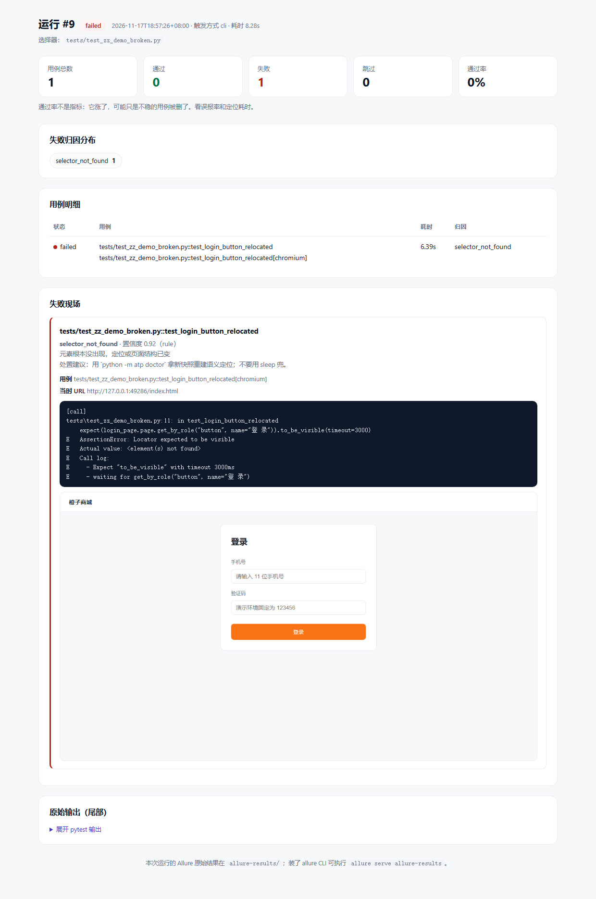

# AI 测试平台

[](https://github.com/skyline66/ai-test-platform/actions/workflows/smoke.yml)

> 按《AI测试54：Playwright+PO 到 AI 测试平台》的**大框架**搭出来的一套可运行骨架。
> 不是 PPT 架构，`git clone` 之后十分钟内能跑出「一句话 → 草稿 → 执行 → 带截图的报告 + 失败归因」的完整闭环。

原文一句话，就是整个仓库的设计约束：

> **UI 自动化的成本不在「写第一版」，在「改第 41 次」。**
> 录制解决起步，Allure 解决可追溯，PO 解决可维护，Cursor + MCP 解决写定位，
> 平台解决「谁来跑、什么时候跑」。顺序反了，你搭的只是一个更脆的脚本堆。

- 原文：<https://mp.weixin.qq.com/s/LpnSpiA5kGdgecWRH4fPvw>
- 文章要点 → 代码位置：[`docs/article-map.md`](docs/article-map.md)
- 架构与取舍：[`docs/architecture.md`](docs/architecture.md)





---

## 这是什么 / 不是什么

**是**：一条能跑的流水线，和一套能被机器检查的分层纪律。

- 12 条真实可跑的 UI 用例（跑完约 7 秒），带内置演示站，**离线可跑，不依赖任何外部环境**
- 定位全在 `pages/`，用例层零定位；`python -m atp lint` 把这条纪律变成 CI 闸门
- 失败自动留现场：截图 + 当时 URL + 控制台日志，随报告一起可发给别人
- 失败自动归因：8 类规则（定位失效 / 断言不符 / 环境不一致 / 网络 / 鉴权 / 数据 / 不稳 / 未知）
- 一句话生成用例草稿，**并且真的会被执行验证**（草稿隔离在 `tests/drafts/`，永不自动进冒烟集）
- 执行调度：手动 / 按标记 / 定时（`ATP_SCHEDULE_ENABLED=1` 后每小时自动冒烟）

**不是**：一个功能齐全的商业测试平台。没有通知、没有多租户、没有看板大屏。
文章的判断是「平台是放大器，不是发动机」——先攒够跑得稳的用例，再谈扩展。

---

## 5 分钟跑起来

```bash
git clone <this-repo> && cd ai-test-platform

python -m pip install -r requirements.txt
python -m playwright install chromium

python -m atp lint          # ① 纪律检查：应输出「通过」
python -m atp run --all     # ② 跑全部用例：应 12/12 通过，并生成报告
python -m atp serve         # ③ 打开 http://127.0.0.1:8077
```

没有配置任何 LLM key 也能跑 —— 起草走模板、归因走规则，这是刻意的降级设计。

想看失败长什么样（报告里的归因与截图）：

```bash
# 在 pages/ 里随手改错一个字面量（比如把 "登录" 改成 "登 录"），跑一次，再改回来
python -m atp run tests/test_login.py --triage
```

---

## 大框架：四层分工 + 平台四块

### 一、四层（纪律比架构重要）

```
tests/     只写「步骤」和「断言」        ← 被执行的资产
pages/     只写「定位」和「动作」        ← 页面改了只改这里
utils/     配置 / 日志 / 数据 / 现场保全 ← 公共能力
atp/       平台：调度 / 分析 / 管理 / 环境 ← 不含用例
```

三条边界，都能被 `python -m atp lint` 查出来：

| 规则 | 内容 | 为什么 |
| --- | --- | --- |
| `TESTS-001` | 用例层不许出现 `locator(` / `xpath` / `nth-child` / `#id` | 选择器只在一处，改版只改一个文件 |
| `TESTS-002` | 用例层不许直接 `.click(` / `.fill(` | 动作归页面对象，用例只描述业务 |
| `PAGES-001` | 页面对象不许写 `assert` / `expect(` | 页面只回答「怎么点」，不回答「点了算不算对」 |

> 能 grep 出来的规范，才是能执行的规范。

### 二、平台四块（按重要性排，不是按做起来爽的顺序）

| 优先级 | 模块 | 实现 | 怎么验证 |
| --- | --- | --- | --- |
| ① 执行调度 | 每次运行一个独立目录、产物隔离、同一时刻只跑一份 | `atp/runner.py`、`atp/scheduler.py` | `python -m atp run -m smoke` |
| ② 结果分析 | 归因分布 + 失败现场 + 单文件自包含报告 | `atp/triage.py`、`atp/report.py` | `python -m atp triage` |
| ③ 用例管理 | 静态扫描 `tests/` 做索引，不维护第二份清单 | `atp/registry.py`、`atp/store.py` | `python -m atp cases` |
| ④ 环境与数据 | 浏览器版本 / 时区 / 字体 / 代理 / 账号全部固化 | `atp/config.py`、`Dockerfile` | `GET /api/env` |

很多人从「用例管理」做起，做完发现最痛的其实是「谁在什么时候跑、挂了通知谁」——所以调度排第一。

---

## 闭环演示：一句话 → 草稿 → 跑 → 报告

```console
$ python -m atp draft "登录成功后加入购物车并结算" --write
provider = template｜valid = True
已写入：tests/drafts/test_draft_12d863.py

$ python -m atp run tests/drafts/test_draft_12d863.py --triage
运行 #6 · passed · 4.59s
用例 1｜通过 1｜失败 0｜跳过 0｜通过率 100%
报告文件：artifacts/runs/20261117-185346/report.html
```

生成的草稿长这样（`tests/drafts/`，带 `pytest.mark.draft`）：

```python
@allure.feature("登录")
@allure.title("登录成功后加入购物车并结算")
def test_draft_12d863(login_page):
    """登录成功后加入购物车并结算"""
    # 步骤 1
    inventory = login_page.login_as(VALID_ACCOUNT)
    # 步骤 2
    expect(inventory.heading).to_be_visible()
    # 步骤 3
    inventory.add_to_cart(PRODUCTS[0])
    ...
```

它不只是「看起来对」：草稿会过 `ast` 语法校验 + PO 纪律检查，然后**真的被执行一遍**。
没识别出来的动作不会被编造成断言，而是留成 `# TODO 待补业务断言：...`。

失败时的报告（见顶部第二张图）会给出：归因分类、置信度、判断理由、处置建议、
当时 URL、完整报错、失败截图、控制台日志。

---

## 命令速查

```bash
python -m atp run --all                  # 全部用例（含 draft）
python -m atp run -m smoke --triage      # 只跑冒烟 + 立即归因
python -m atp run tests/test_login.py::test_login_success
python -m atp lint                       # PO 纪律检查（CI 闸门）
python -m atp triage                     # 归因最近一次运行
python -m atp cases                      # 列出用例与标记、上次结论
python -m atp draft "需求一句话" --write   # 生成草稿
python -m atp doctor --locator "<旧定位>" --url <页面地址>   # 改版后重建语义定位
python -m atp serve                      # 启动平台（默认 127.0.0.1:8077）
python -m atp report                     # 打印最近一次报告路径
```

裸 pytest 也能用（不经过平台）：

```bash
python -m pytest tests -v
python -m pytest tests -m smoke
```

## HTTP 接口

| 方法 | 路径 | 作用 |
| --- | --- | --- |
| GET | `/api/env` | 环境信息（浏览器修订号、时区、被测地址、LLM 状态） |
| GET | `/api/cases` | 用例索引 + 上次结论 |
| POST | `/api/cases/draft` | 一句话 → 草稿 |
| POST | `/api/runs` | 触发运行（同步返回结果） |
| GET | `/api/runs`、`/api/runs/{id}` | 运行历史 / 详情 |
| GET | `/api/runs/{id}/report` | 报告 HTML |
| GET | `/api/runs/{id}/triage` | 归因结果 |
| GET/POST | `/api/schedule` | 定时冒烟配置 |
| GET/POST | `/api/lint` | PO 纪律检查 |
| POST | `/api/doctor` | 定位重建 |

---

## AI 在这里的位置：填空，不是替代

文章说 Agent 擅长三件事，这个仓库一一对应：

| 文章里的三件事 | 实现 | 边界 |
| --- | --- | --- |
| 把一句需求写成用例草稿 | `atp/authoring.py` | 只出草稿，必须人工去掉 `draft` 标记才进冒烟集 |
| 把失败日志归到某一类原因 | `atp/triage.py` | 规则优先；模型只在置信度 < 0.8 时补措辞，不参与定结论 |
| 页面改版后批量修定位 | `atp/locator_doctor.py` | 只输出候选+打分，最终抽三条人工验一遍 |

**它不擅长定标准。**「什么算通过」这件事写在 `tests/` 里，由人写，平台不生成。
模型写得出「能跑的定位」，写不出「稳的定位」——所以约束必须落成检查和文档，
见 [`docs/ai-constraints.md`](docs/ai-constraints.md)（四段式任务书：目标 / 参考 / 约束 / 验收）。

配置任意 OpenAI 兼容端点即可启用模型（DeepSeek / Qwen / vLLM / Ollama 都行）：

```bash
export ATP_LLM_BASE_URL=https://api.deepseek.com/v1
export ATP_LLM_API_KEY=sk-xxx
export ATP_LLM_MODEL=deepseek-chat
```

不配也能跑：`llm.py` 统一抛 `LLMUnavailable`，调用方各自降级到模板 / 规则。

---

## 环境固化：先把镜像钉死，再谈调度

平台跑在服务器上，浏览器版本、时区、字体、网络代理，任何一样和本地不同，用例就挂给你看。

- `Dockerfile`：`python:3.12-slim` + tzdata + **中文字体**（缺字体时中文渲染成方块，会直接把「文案可见」断言搞挂）+ `playwright==1.55.0` 自带的 chromium 修订号
- `requirements.txt`：所有版本钉死，不用 `>=`
- `docker compose up -d`：起服务 + 每小时自动冒烟，`artifacts/` 挂出来

```bash
docker compose up -d --build
# 然后访问 http://127.0.0.1:8077
```

## CI

`.github/workflows/smoke.yml`：push / PR / 每天 09:00（Asia/Shanghai）/ 手动触发。

顺序是刻意的 —— 先跑不需要浏览器的平台自测（几秒），再跑纪律检查，最后才开浏览器跑冒烟；
失败时上传 `artifacts/`（报告 + 截图 + allure 原始结果，保留 7 天）。

---

## 为什么这样设计（取舍）

| 选择 | 理由 | 代价 |
| --- | --- | --- |
| sqlite 而不是 Postgres | 一个文件就是全部状态，备份=复制 | 多人并发写要换库 |
| 不用 ORM | 早期最不需要的就是「表结构比用例还复杂」 | 复杂查询手写 SQL |
| 用例真源是 `tests/` 里的 `.py` | 不维护第二份清单，不存在表与代码漂移 | 平台无法记录「非代码」用例 |
| 模板兜底 + 模型可选 | CI 不能依赖外部模型 | 生成质量有上限 |
| 自渲染 HTML 报告 | Allure 管「可追溯」，平台管「一眼看懂」 | 多维护一个模板 |
| 单文件前端、无构建链 | 平台早期不该有前端构建 | 复杂交互会受限 |
| `RUN_LOCK` 禁止并行 | 并发跑同一套浏览器用例，失败八成是你自己 | 慢 |
| 草稿不自动进冒烟集 | 人工确认是流水线的一部分 | 需要有人点一下 |

## 已知限制 / 路线图

- [ ] **通知**：现在挂了不出声。`triage` 已有结构化结果，接企业微信 / 飞书 webhook 只是拼一条消息
- [ ] **误报率统计**：报告已印着「看误报率别看通过率」，但还没算这个数（需要人工标记误报）
- [ ] **定位耗时**：同上，需要给每步埋点
- [ ] **多环境切换 UI**：目前靠 `ATP_BASE_URL`
- [ ] **并行执行**：需要先做到用例级隔离

---

## 目录结构

```
ai-test-platform/
├── atp/                     # 平台内核（不含用例）
│   ├── api.py               #   FastAPI 路由
│   ├── authoring.py         #   一句话 → 用例草稿
│   ├── cli.py               #   命令行
│   ├── config.py            #   配置（ATP_* 环境变量）
│   ├── lint.py              #   PO 纪律检查
│   ├── llm.py               #   OpenAI 兼容客户端（可空）
│   ├── locator_doctor.py    #   改版后批量重建定位
│   ├── models.py            #   数据模型
│   ├── registry.py          #   用例索引（扫 tests/）
│   ├── report.py            #   报告渲染
│   ├── runner.py            #   执行器（pytest 子进程 + 结果解析）
│   ├── scheduler.py         #   定时冒烟
│   ├── store.py             #   sqlite 归档
│   ├── static/index.html    #   网页
│   └── templates/report.html
├── pages/                   # PO 层：只有定位和动作
│   ├── base_page.py
│   ├── login_page.py
│   ├── inventory_page.py
│   └── components/          #   导航栏、购物车弹窗（跨页复用）
├── tests/                   # 用例层：只有步骤和断言
│   ├── conftest.py          #   环境、夹具、失败现场
│   ├── test_login.py
│   ├── test_inventory.py
│   └── test_cart.py
├── platform_tests/          # 平台自测（17 条，无需浏览器）
├── utils/                   # 配置 / 日志 / 数据 / 现场 / 演示站
├── demo_app/                # 内置演示站（离线可跑的被测对象）
├── docs/                    # 架构 / 文章对照 / AI 约束 / 开工清单
├── Dockerfile
├── docker-compose.yml
├── .github/workflows/smoke.yml
├── requirements.txt
├── pyproject.toml
├── Makefile
└── .env.example
```

## 出处与许可

- 方法论出处：《AI测试54：Playwright+PO 到 AI 测试平台》，[原文链接](https://mp.weixin.qq.com/s/LpnSpiA5kGdgecWRH4fPvw)
- 本仓库是该框架的工程实现，代码 MIT 许可，见 [LICENSE](LICENSE)

> 工具决定你能跑多快，判断决定你跑的方向对不对——前者一年能补上，后者得靠一个个项目攒。